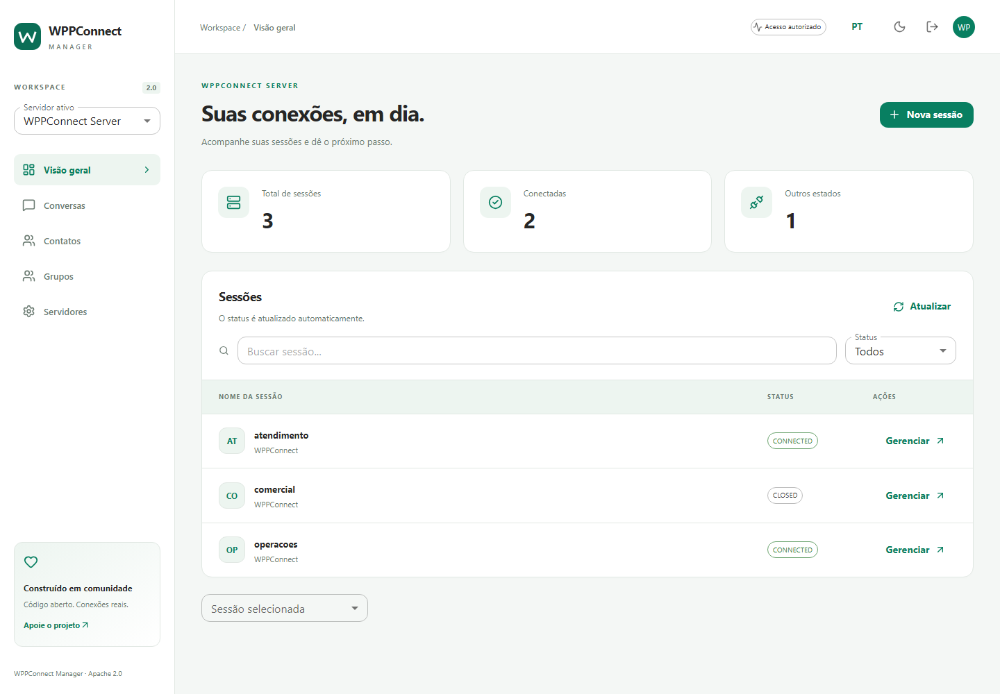

**English** | [Português (Brasil)](./README.pt-BR.md)

<p align="center">
  <a href="https://wppconnect.io/">
    <picture>
      <source media="(prefers-color-scheme: dark)" srcset="https://wppconnect-team.github.io/brand/v2/wppconnect-dark.png" />
      
    </picture>
  </a>
</p>

# WPPConnect Manager

Manage WPPConnect Server sessions and conversations in a self-hosted web workspace.

A project in the WPPConnect ecosystem, maintained by WPPConnect Team.

[Getting started](#getting-started) | [Documentation](#documentation) | [Contributing](#contributing) | [Support WPPConnect](#support-the-project)

[](./LICENSE) [](https://github.com/wppconnect-team/wppconnect-manager/actions/workflows/ci.yml) [](https://wppconnect.io/) [](https://opencollective.com/wppconnect)

## Overview

For operators of WPPConnect Server. Previously `wppconnect-frontend`, version 2 replaces the demonstration frontend with React, TypeScript, Vite and Material UI while preserving history and licensing. This UI requires a separate Server implementing Manager protocol 1 (`GET /api/manager/info`).

## Features

- Multiple server profiles; session inventory, QR refresh, start/reconnect, close, logout and cleanup.
- Administrator or session-restricted access; credentials remain in memory.
- Chats, contacts, groups and media with a 20 MB UI attachment limit; authenticated real-time events.
- English/Portuguese, light/dark themes and desktop/mobile layouts.



Screenshots and browser tests use synthetic data. Live pairing, send/receive and media availability depend on the connected Server and WhatsApp; unavailable history/media are reported as errors.

## Getting started

Use an existing WPPConnect Server with Manager protocol 1 and Docker:

```sh
docker run --rm -p 8080:80 \
  -e MANAGER_SERVER_URL=http://localhost:21465 \
  ghcr.io/wppconnect-team/wppconnect-manager:2.0.0
```

Open `http://localhost:8080/manager/`. Provide the server secret for administration, or a session name/token for restricted access. The integrated Server image serves the UI at `http://localhost:21465/manager/`. For local UI development use Node.js `>=22.12` (CI uses 22.22.2), then `npm ci` and `npm run dev`.

## Configuration

`MANAGER_SERVER_URL` must be reachable by the browser, without credentials in the URL. The container creates `/manager/config.js` at startup; restart/recreate to change it. Source builds use [public/config.js](public/config.js). Use HTTPS for both UI and API remotely. Proxies must forward `/api/`, `/manager/` and `/socket.io/` with WebSocket upgrades. Only profile names/URLs, language and theme persist in browser storage. Reloading requires credentials again. Old `window.IP_SERVER`, `window.IP_SOCKET_IO` and `@WPPConnect-Token` settings are not imported. Close a session before clearing its data. Pin image versions; rollback requires a Server and UI with compatible protocols.

## Documentation

- [Standalone Compose setup](./compose.yaml)
- [Server integration](https://github.com/wppconnect-team/wppconnect-server/blob/main/docs/manager.md)
- [Release bundles and checksums](https://github.com/wppconnect-team/wppconnect-manager/releases)
- [Retained technical details and acknowledgments](documentation/readme-reference.md)

## WPPConnect ecosystem

| Project | Purpose | When to use it |
| --- | --- | --- |
| [WPPConnect Server](https://github.com/wppconnect-team/wppconnect-server) | Run a REST API for WhatsApp sessions, messages and webhooks. | Expose session and messaging operations over HTTP. |
| [WPPConnect Server CLI](https://github.com/wppconnect-team/server-cli) | Start WPPConnect Server from the `wppserver` command. | Launch the Node.js Server from a terminal. |

## Support the project

WPPConnect is maintained by an open-source community. Your support helps fund maintenance, infrastructure, documentation, and the people working on the ecosystem.

If WPPConnect helps your project or business, consider making a one-time contribution or becoming a recurring supporter.

**[Support WPPConnect on Open Collective](https://opencollective.com/wppconnect)**

Contributions are voluntary. See the official page for current financial information. You can also help with code, tests, documentation, translations and well-described issue reports.

Additional official beneficiaries in [.github/FUNDING.yml](.github/FUNDING.yml): [joaosouz4dev](https://github.com/sponsors/joaosouz4dev), [manfe](https://github.com/sponsors/manfe).

## Contributing

Contributions of code, tests, examples, documentation and translations are welcome. For larger changes, discuss the approach in an issue first. Include the project/runtime versions, a minimal reproduction and sanitized logs when reporting a problem. Update both `README.md` and `README.pt-BR.md` in the same change when installation, configuration, features, examples, licensing or funding changes.

After installing the development dependencies, use the repository checks relevant to your change:

```sh
npm run lint
npm run typecheck
npm test
npm run build
npm run test:e2e
```

Account-dependent examples and tests require separate validation with an authorized test account. Never attach credentials or session files to an issue.

## Community and support

Use [repository issues](https://github.com/wppconnect-team/wppconnect-manager/issues) for reproducible bugs and feature proposals. For usage questions, join the community through the official channels:

- [Discord](https://discord.gg/JU5JGGKGNG)
- [Telegram](https://t.me/wppconnect)
- [YouTube](https://www.youtube.com/c/wppconnect)

This project is independent and is not affiliated with or endorsed by WhatsApp or Meta. Follow applicable terms and obtain authorization for account and messaging operations.

## License

[Apache License 2.0 (Apache-2.0)](./LICENSE).

Copyright WPPConnect Team and contributors.

The original legal document and existing copyright notices are preserved. Third-party components retain their own terms.
