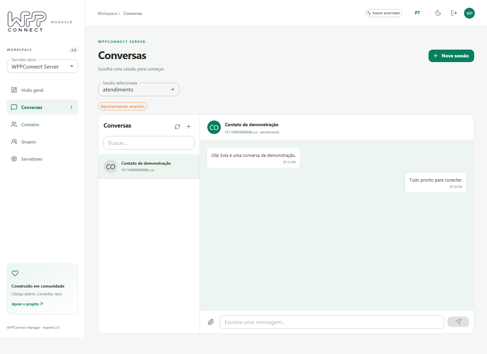

# Retained README reference / Referência preservada do README

This document preserves the previous `README.md` for technical details, acknowledgments and history. Start with [README.md](../README.md) or [README.pt-BR.md](../README.pt-BR.md) for the current verified entry path. Older commands, release claims, third-party examples and API signatures here may need migration; consult the current source and linked guides.

Este documento preserva o `README.md` anterior com detalhes técnicos, agradecimentos e histórico. Comece pelo [README em português](../README.pt-BR.md) para as instruções iniciais conferidas. Comandos antigos, afirmações sobre releases, exemplos de terceiros e assinaturas de API podem exigir migração; consulte os fontes e guias atuais.

---

<!-- wppconnect-official-brand -->
<p align="center">
  <a href="https://wppconnect-team.github.io/">
    <picture>
      <source media="(prefers-color-scheme: dark)" srcset="https://wppconnect-team.github.io/brand/wppconnect-dark.png" />
      
    </picture>
  </a>
</p>
<!-- /wppconnect-official-brand -->

# WPPConnect Manager

[](https://github.com/wppconnect-team/wppconnect-manager/actions/workflows/ci.yml)
[](../LICENSE)
[](#sponsors)

A self-hosted workspace to manage **WPPConnect Server sessions and conversations**. Switch between servers, connect WhatsApp through QR codes, and work with chats, contacts, groups and attachments.

Previously `wppconnect-frontend`, this repository is maintained again as **WPPConnect Manager**. Version 2 replaces the old demonstration frontend with React, TypeScript, Vite and Material UI. The Git history and Apache-2.0 license are preserved.

[Português](../README.pt-BR.md) · [Server](https://github.com/wppconnect-team/wppconnect-server) · [Releases](https://github.com/wppconnect-team/wppconnect-manager/releases) · [Discord](https://discord.gg/JU5JGGKGNG) · [Telegram](https://t.me/wppconnect)


_Actual application screenshots with synthetic demonstration data, not evidence of a connected WhatsApp account._

## Features

- Multiple local server profiles, one active server at a time.
- Session inventory, search, status filters, QR refresh, start/reconnect, close, logout and data cleanup.
- Administrator access with the server secret key, or restricted access with a session name and its token.
- Chats and history available on the server, text and attachment sending, images, stickers, audio/video playback and file downloads. Attachments are limited to 20 MB in the UI.
- Contacts, groups, new conversations and group creation.
- Authenticated real-time events scoped to the selected session, automatic reconnection and message deduplication.
- Portuguese/English, light/dark themes and responsive desktop/mobile layouts.



## Compatibility and access

Use a WPPConnect Server release containing **Manager protocol 1** (`GET /api/manager/info`). The Manager checks this endpoint before login. An older server must be upgraded; the legacy unauthenticated socket is never used by this UI.

The Manager does not introduce a user database. An administrator provides the server's `SECRET_KEY` and can manage all its sessions. For restricted access, provide a session name and the token generated by that server. The server enforces token/session matching for HTTP operations and the `/manager` Socket.IO namespace.

Only profile names, URLs, language and theme are saved in browser storage. Credentials stay in memory and are requested again after reload, server change or sign-out. They are never placed in the Manager bundle, configuration file or request URLs. Do not put secret keys in `MANAGER_SERVER_URL`.

## Docker: standalone

```bash
docker run --rm -p 8080:80 \
  -e MANAGER_SERVER_URL=http://localhost:21465 \
  ghcr.io/wppconnect-team/wppconnect-manager:2.0.0
```

Open **http://localhost:8080/manager/**. `MANAGER_SERVER_URL` must be reachable by the **browser**; an internal Compose hostname such as `http://server:21465` will usually not work from your desktop. You can also edit/add profiles in the Servers screen.

The included [compose.yaml](../compose.yaml) runs the standalone Manager against an existing server:

```bash
docker compose up -d
```

The container generates `/manager/config.js` on startup, so URL changes require a container restart/recreation, not a rebuild. The container contains static files and Nginx; it does not proxy or store WhatsApp credentials.

## Docker: integrated into the server

The companion server release includes this UI at **http://localhost:21465/manager/**. The default server profile uses the same origin. Set `MANAGER_ENABLED=false` on the server container to disable serving the UI. This does not disable the server API.

The server Dockerfile downloads a **fixed release bundle and verifies its SHA-256 checksum** at build time. It never downloads `latest` when starting a container. See the [server README](https://github.com/wppconnect-team/wppconnect-server#readme) for persistence and server configuration.

## HTTPS and reverse proxies

Serve both the UI and the API over HTTPS when used remotely. An HTTPS page cannot call an HTTP server due to browser mixed-content protection. Forward `/manager/` for the UI, `/api/` for HTTP and `/socket.io/` with WebSocket upgrade support to the server. The socket namespace is `/manager`, but the transport endpoint remains `/socket.io/`.

When using a server mounted below a prefix, configure its externally reachable base URL, such as `https://example.com/whatsapp`. The reverse proxy must preserve that prefix consistently for API and socket traffic. The Manager UI itself is served at `/manager/`.

## Local development

Node **22.22.2** is used in CI and Docker. Use the committed npm lockfile.

```bash
npm ci
npm run dev
```

Open the printed `/manager/` URL. Add your server in **Servers**; the Vite development server is not a WhatsApp API. For a deployment-wide default, edit `public/config.js` before building. Do not add credentials.

```bash
npm run lint
npm run typecheck
npm test
npm run build
npx playwright install chromium
npm run test:e2e
```

Browser tests use synthetic HTTP fixtures and cover desktop/mobile flows; they do not send WhatsApp messages. Release CI also builds and starts the Docker image and checks routing and runtime configuration. Real WhatsApp pairing/send/receive must be validated separately with an authorized test account.

## Upgrade and rollback

This is a major UI replacement. Old `window.IP_SERVER`/`window.IP_SOCKET_IO` and `@WPPConnect-Token` browser settings are not imported. Configure server profiles again. Existing WhatsApp sessions and server tokens remain on the server.

Pin image versions in production. For rollback, restore the previously recorded server image tag/digest and standalone Manager tag/digest; this UI has no database migration. Rolling back to a server without Manager protocol 1 requires the matching older UI.

Releases publish `wppconnect-manager.tar.gz`, `SHA256SUMS`, and the GHCR image. Only tag after the PR checks succeed; the tag workflow repeats validation before publishing.

## Troubleshooting

| Symptom                      | Check                                                                                                                |
| ---------------------------- | -------------------------------------------------------------------------------------------------------------------- |
| Login cannot connect         | Browser-visible URL, HTTPS/CORS, secret key/token, and `/api/manager/info` protocol 1.                               |
| QR unavailable               | Start the session, wait for its pairing state and keep the page open. Connected or closed sessions do not have a QR. |
| Events reconnecting          | Reverse proxy WebSocket upgrades, `/socket.io/` transport path, and the selected session token.                      |
| History or media unavailable | The server and WhatsApp must still have that history/media; an API error is shown instead of a fabricated result.    |
| Clear data returns conflict  | Close the session first. Cleanup deliberately rejects active sessions and symlink directories.                       |
| Credentials requested again  | Expected after reload: secrets are not stored persistently.                                                          |

This is a session/chat manager, not a Docker daemon controller, multi-user helpdesk or shared credential vault. Availability of message features follows the connected server; unsupported operations are reported as errors.

## Sponsors

Support the people maintaining WPPConnect:

- [Sponsor joaosouz4dev](https://github.com/sponsors/joaosouz4dev)
- [Sponsor manfe](https://github.com/sponsors/manfe)
- [WPPConnect on Open Collective](https://opencollective.com/wppconnect)

Funding matches WPPConnect Server's published configuration. Thank you to contributors and sponsors who keep the project available to everyone.

## License

[Apache-2.0](../LICENSE). Copyright WPPConnect Team and contributors. This project is not affiliated with WhatsApp or Meta.
